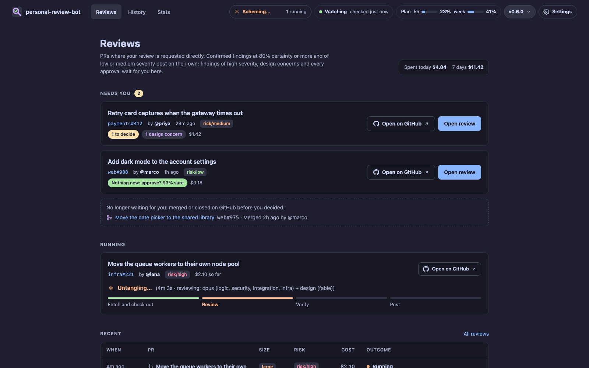
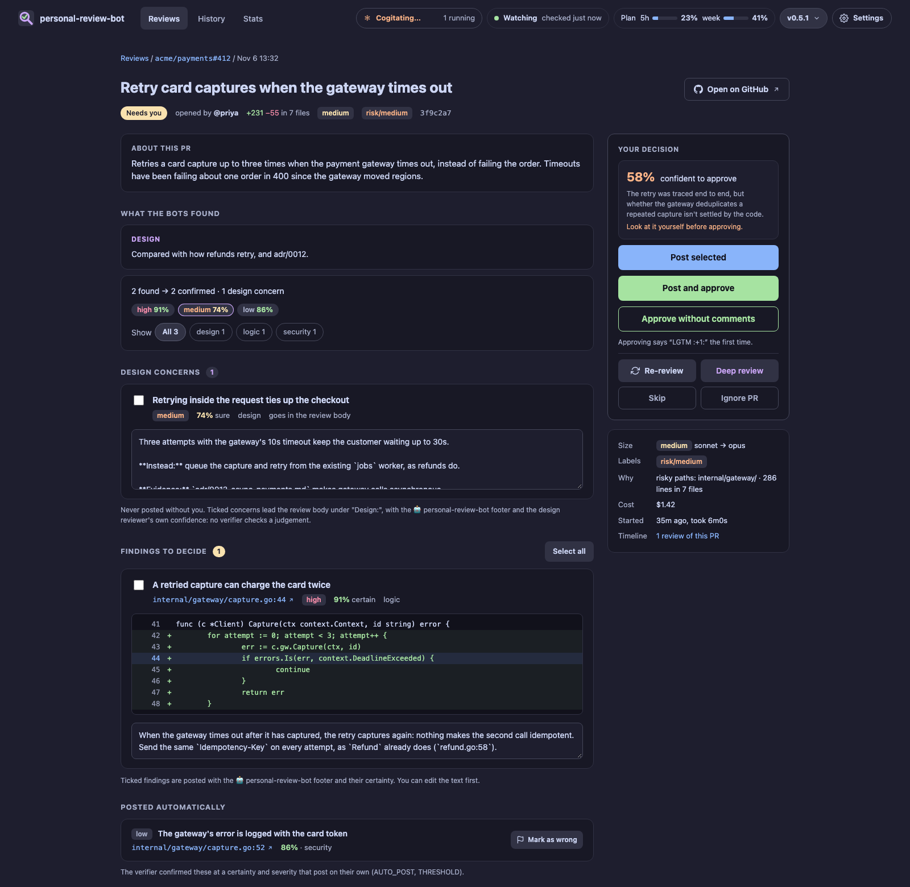
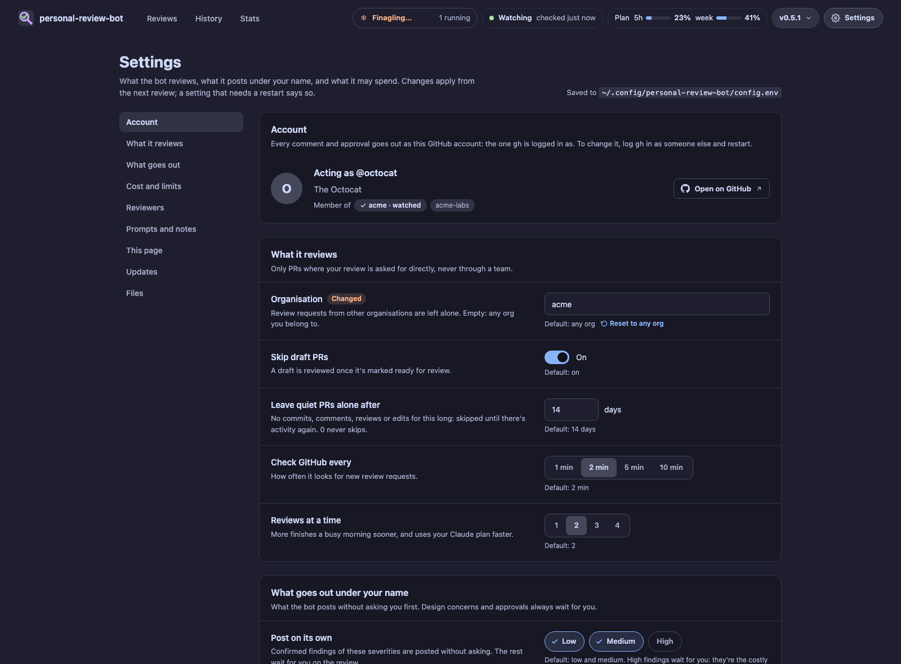

#  personal-review-bot

[](https://github.com/badam1/personal-review-bot/actions/workflows/ci.yml)

A PR review bot that works for **you**, from your laptop. When someone asks for your review on GitHub, it reviews the
PR with [Claude Code](https://claude.com/claude-code) agents, has a second agent check every finding, posts only what
holds up, and leaves the rest to you on a local page. **It never approves on its own.**

No server, webhook or org-admin rights: it polls GitHub with your `gh` login and runs `claude -p` with your Claude
login.



## How it works

1. **It watches** for review requests addressed to you directly, not to a team you're in, every 2 minutes.
2. **It sizes the PR.** Lines changed and risky paths (Terraform, IAM and auth, prod, migrations…) make it small,
   medium or large, and pick the models: Haiku, Sonnet or Opus reviewers, and a verifier never weaker than Sonnet. As
   your Claude plan fills up, it moves to cheaper models from 75% of the 5-hour or weekly limit, and to the cheapest,
   without the design review, from 90%.
3. **It reviews.** Reviewers for logic, security, integration with other services and, when infra files change,
   infra and rollout run in parallel, read-only, in a checkout of the PR; they can read the org's other repos but post
   nothing. You can change them or add your own. A **design reviewer** judges the approach on the first review of a
   medium or large PR, on PRs that touch an ADR and on reviews you start; on a re-review, a **follow-up check** says
   what became of each earlier finding.
4. **It verifies.** A separate verifier checks every finding against the code and rates how certain it is that the
   problem is real and how severe it would be. It also says how confident it is that nothing else stands in the way of
   approving, and a short summary of what the PR does goes at the top.
5. **It posts only what is confirmed, at least 80% certain, and of low or medium severity**, as one comment review.
   Each comment is signed, e.g. `🤖 personal-review-bot · 92%`. High-severity findings, design concerns, anything less
   certain and every approval wait for you, with a desktop notification.

## Install

You need macOS or Linux with:

- [`gh`](https://cli.github.com/), logged in (`gh auth login`). Repos are cloned with its credentials.
- [Claude Code](https://claude.com/claude-code), logged in with a Claude plan or an API key. Reviews count towards
  its limits or bill.
- `git`, and [Go](https://go.dev/dl/) (the version in `go.mod`) to build it.
- Optional: [`terminal-notifier`](https://github.com/julienXX/terminal-notifier) on macOS (clicking a notification
  opens the review) or `notify-send` on Linux.

```sh
git clone https://github.com/badam1/personal-review-bot.git
cd personal-review-bot
git checkout "$(git describe --tags --abbrev=0)"  # the latest release
./install.sh                                       # builds it and starts the background service
```

The service is a launchd agent on macOS (log: `~/Library/Logs/personal-review-bot.log`) and a systemd user service on
Linux (log: `journalctl --user -u personal-review-bot`; `loginctl enable-linger` keeps it running while you're logged
out). It uses the `PATH` you ran `./install.sh` from, so re-run it after moving `gh`, `git` or `claude`.

On its first start it skips the review requests that are already open rather than reviewing them all at once; press
`r` on one in the terminal UI to review it.

[Releases](https://github.com/badam1/personal-review-bot/releases) also have prebuilt binaries for macOS and Linux
(arm64 and amd64), with checksums and build attestations (`gh attestation verify <file> -R badam1/personal-review-bot`).
They aren't notarized: on macOS, run `xattr -d com.apple.quarantine personal-review-bot` once.

## Use

Open <http://localhost:12346>. The bar on every page shows what is running, whether the bot is watching GitHub, how
full your Claude plan is, and the version menu.



- **Reviews**: what needs you, what is running and the step it's on, failed reviews to retry, and the latest ones.
- **A review**: each finding with the code around it and the verifier's certainty. Tick what to post (and edit it),
  then post, approve, or both. A posted finding that turned out wrong can be marked wrong; later reviews are told.
- **Re-reviews** count the earlier findings ("3 fixed, 1 still open") and let you remind the author of the open ones,
  in their threads.
- **Deep review** reviews the PR again as if it were large (Opus, the design review, no savings), for a small PR that
  deserves more.
- **History** has every review, filtered by repo, author or status; **Stats** has spend and what became of findings,
  by reviewer, model, PR size and repo.
- **Settings**: see [below](#settings).

From a terminal:

```sh
personal-review-bot                       # what's running and the last 10 reviews
personal-review-bot review --dry-run URL  # try it on any PR: posts nothing
personal-review-bot queue [--deep] URL    # hand a PR to the running bot
personal-review-bot agents                # the reviewers and prompts reviews run with
personal-review-bot update [--check]      # install the newest release
```

## Settings

**Settings** in the bar changes everything below, the reviewers and the prompts, and shows the GitHub account it all
goes out as. A change applies from the next review, without a restart (only `ADDR` needs one). Turning on posting
high-severity findings without asking takes a confirmation, and a reviewer or prompt is checked before it's saved.



The settings live in `~/.config/personal-review-bot/config.env` (`$XDG_CONFIG_HOME` is respected), as `NAME=value`
lines. The page rewrites only the lines you change and keeps your comments. A `PERSONAL_REVIEW_BOT_<NAME>` environment
variable wins over the file, and the page shows that setting locked. After editing the file by hand, run
`./install.sh` to restart.

| Name | Default and meaning |
|---|---|
| `ORG` | empty: any org. Only review PRs in these GitHub orgs — one, or several as `acme,umbrella`; a value that isn't an organisation name is refused rather than searched for. Reviewers search one for related repos: the PR's own when you set it, otherwise the repo's owner |
| `THRESHOLD` | `80`: how certain (%) a confirmed finding must be to post on its own |
| `AUTO_POST` | `low,medium`: the severities that post on their own; `low,medium,high` for all, empty for none |
| `APPROVE_TEXT` | `LGTM :+1:`: said with your first approval of a PR; empty approves without a comment |
| `WATERMARK` | `🤖 personal-review-bot`: ends every comment the bot posts, followed by its certainty |
| `SHOW_LABELS` | `risk/,auto-risk/`: PR labels to show, by prefix, in a column of the lists and on a review, coloured by the level they end in (`/high`, `/medium`, `/low`) |
| `LABELS_TITLE` | empty: that column's heading, named after the labels (`risk/` and `auto-risk/` make it Risk) |
| `SAVE_AT` | `75`: % of the plan's 5-hour or weekly limit from which reviews use cheaper models |
| `MIN_AT` | `90`: % from which they use the cheapest, without the design review |
| `POLL_SECONDS` | `120`: how often to look for review requests |
| `PARALLEL` | `2`: reviews at a time |
| `AGENT_TIMEOUT_MINUTES` | `20`: how long one reviewer may run |
| `SKIP_DRAFTS` | `1`: leave draft PRs until they're ready |
| `MAX_AGE_DAYS` | `14`: skip PRs with no activity for this long, until there is some; `0` never skips |
| `ADDR` | `127.0.0.1:12346`: where the page is served, on this computer only |
| `UPDATE_CHECK` | `1`: look for new releases every hour; `0` only when you ask |
| `UPDATE_REPO` | `badam1/personal-review-bot`: where releases come from, for a fork that publishes its own |
| `STATE_DIR` | `~/.local/state/personal-review-bot`: the database |
| `CACHE_DIR` | `~/.cache/personal-review-bot`: repo clones |

## Customize the reviewers and prompts

What the agents are told lives in Markdown files in the config directory. The Settings page edits them, or you can by
hand:

```text
~/.config/personal-review-bot/
├── config.env
├── context.md          notes every prompt gets: where your ADRs live, how tasks are tracked, house rules
├── agents/
│   ├── security.md     changes the built-in security reviewer
│   ├── integration.md  "enabled: false" switches it off
│   └── cost.md         a reviewer of your own
└── prompts/
    └── design.md       replaces the built-in design prompt
```

`personal-review-bot agents export /tmp/prb` writes out the built-in files to start from, and
`personal-review-bot agents` shows what reviews will run with and checks your files. Changes apply from the next
review. A prompt you replace no longer gets the improvements new versions bring, so copy only what you change.

**A reviewer** is `agents/<name>.md` (lowercase letters, digits and dashes): front matter, then what to look for.

```markdown
---
area: cloud cost         # what it reviews, in a few words
paths: \.(tf|tfvars)$    # runs only when a changed file matches (a Go regexp); leave it out for every PR
docs: false              # true: also runs on PRs that only change docs
model: opus              # pins a model; leave it out to follow the PR's size
enabled: true            # false switches it off
---
Resources sized or priced above what the change needs: instance types, replicas, storage classes, missing
lifecycle rules. Report only what costs real money, with the cheaper setting.
```

A file named after a built-in reviewer (`logic`, `security`, `integration`, `infra`) changes only what it sets:
`model: opus` alone pins the security reviewer to Opus.

**Prompts** (`review`, `verify`, `design`, `followup`, `summary`) are Go
[templates](https://pkg.go.dev/text/template) with fields such as `.Repo`, `.Title`, `.Diff`, `.Conversation`,
`.Prior` (earlier findings) and `.Context`. Keep each asking for the same answer as the built-in one: the JSON it
returns is checked.

**`context.md`** goes into every prompt, marked as written by you, so the agents can rely on it, unlike the PR's
description. Use it for what they can't find in the repo: where org-wide ADRs live, how to find the task behind a PR,
which shared modules everything should use.

## Updating

The version menu in the bar says when a new release is out. **Update and restart** there (or `u` in the terminal UI,
or `personal-review-bot update`) downloads it, installs it only if it matches the release's checksum and GitHub
attests it was built by this repo's release workflow, lets the running reviews finish, and restarts. Until 1.0, a
minor release (0.x.0) may change settings, and its notes say what to do.

## Safety

- **Reviewers can't write to GitHub.** They have read-only tools; reading the GitHub API goes through a GET-only
  `gh-read`, and `gh api` is denied. Only the bot's own code posts: comment reviews, and the approvals you click.
- **Unverified findings never post on their own.** If the verifier fails, everything waits for you.
- **Nothing outside your computer can drive the page.** It listens on 127.0.0.1, checks the Host header, refuses
  cross-site requests, needs a secret token for every action, and runs only its own scripts.
- **Updates are verified** against the checksum and the build attestation, and only start when you ask.
- **No transcripts are kept** (`--no-session-persistence`). Each Claude run has `PERSONAL_REVIEW_BOT_AGENT=1` set,
  so your own Claude Code hooks can recognise them.

## Contributing

See [CONTRIBUTING.md](CONTRIBUTING.md).

## License

[MIT](LICENSE)
